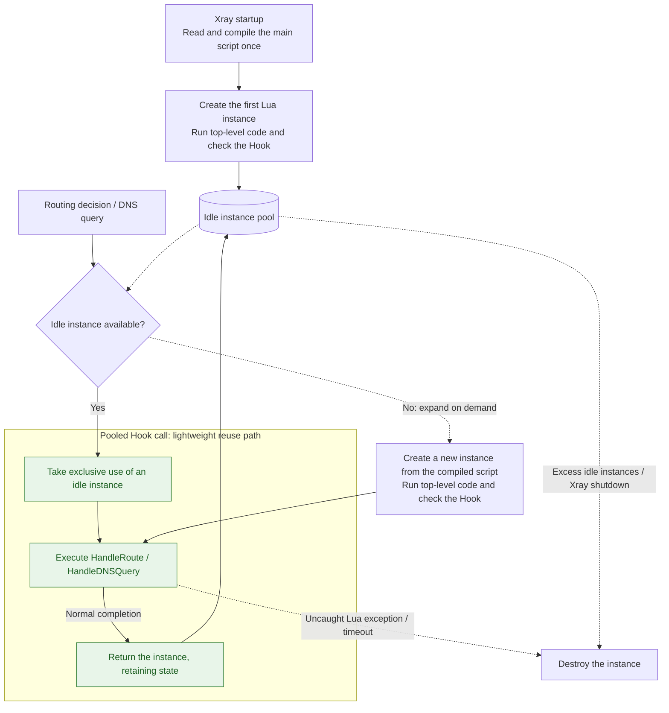

# Instances and Lifecycle

The instance management strategy used by a script entry point determines how Lua instances are created, Hooks are called, state is retained, and instances are destroyed. This page describes these rules by lifecycle type.

## Pooled Lifecycle

Currently, [HandleRoute](../reference/hook-routing.md) in [routing scripts](./routing.md) and [HandleDNSQuery](../reference/hook-dns.md) in [DNS scripts](./dns.md) use pooled instances. The following rules apply to both Hooks.

### Instance Pools and Initialization

Routing and DNS scripts are bound through the `script` field in their respective configurations and manage separate Lua instance pools. Even when configured to use the same file, they do not share state within Lua instances.

At startup, Xray reads and compiles the script once, creates the first instance, executes its top-level code, and checks that the required handler exists. Failure to read the file, parse it, execute top-level code, or validate the handler prevents Xray from starting.

### Hook Calls and Instance Recycling

Each routing decision or DNS query exclusively uses one instance. An idle instance is reused when available; when concurrent calls require more instances, new ones are created from the compiled script and the top-level code runs again.

After a handler completes normally, the instance can return to the pool for reuse. An uncaught Lua exception or execution timeout destroys the instance. Reporting a business error through return values, or failing return-value validation, is not a Lua execution exception: the instance can still be reused. Excess idle instances are destroyed automatically.

When an idle instance is available, each Hook follows a lightweight path: **take an instance → execute the Hook → return the instance**. The script is read and compiled at Xray startup. The green nodes in the diagram show this normal path.



### State in Pooled Instances

Global variables, top-level `local` variables, closures, and the `require` module cache belong to the current instance. They persist across calls handled by that instance and are lost when it is destroyed:

```lua
local calls = 0

function HandleRoute()
    calls = calls + 1
    return "direct", "instance-call-" .. calls
end
```

The counter above only counts calls handled by the current instance. Different instances have independent `calls` values, and requests are not guaranteed to use the same instance. It cannot serve as a counter shared by all connections or as persistent state for a particular connection.

Place initialization code, such as loading Lua modules, creating matchers, and saving DNS server objects, outside the Hook function at the script's top level. It runs once when each instance is created, and subsequent Hook calls on that instance can reuse the results.

### Timeouts and Script Updates

Currently, each routing and DNS instance has an initialization timeout of **120 seconds**, and each handler call has an execution timeout of **6 seconds**. The call timeout starts after an instance is acquired; these values currently have no separate configuration fields. When calling Xray APIs, cancellation also depends on whether the API responds to cancellation signals; each DNS server is additionally limited by its `timeoutMs` setting.

Xray does not automatically watch or recompile the main script. Restart Xray after changing it for the changes to take effect. Instances created later also use the main script compiled during the current startup.
