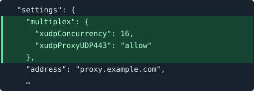
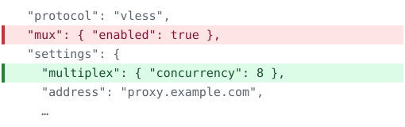

# Multiplex

Multiplex позволяет нескольким запросам к разным адресам использовать одно соединение между клиентом Xray и сервером. Например, когда браузер открывает сайт, клиент может передать запросы к странице, изображениям и другим ресурсам по уже открытому соединению. Для передачи UDP-пакетов через такое соединение Xray использует XUDP.

## Какие подключения поддерживаются

Multiplex можно включить на клиенте для **исходящего VLESS или VMess**. Он объединяет потоки между этим клиентом и сервером. На стороне сервера VLESS или VMess распознаёт команду автоматически.

Для остальных исходящих протоколов, в том числе Shadowsocks, Trojan, SOCKS и HTTP, эта настройка недоступна. Если приложение подключается к клиенту Xray по SOCKS, а клиент отправляет трафик дальше через VLESS, Multiplex можно включить на участке VLESS. На входе SOCKS ничего менять не требуется.

## Где задать настройки

В массиве `outbounds` найдите запись нужного сервера и добавьте объект `multiplex` внутрь её `settings`, рядом с `address`, `port` и `id`. Полный путь в JSON — `outbounds[].settings.multiplex`. Если исходящих подключений несколько, каждое настраивается отдельно.

## Общий пул соединений

### `concurrency`

Задаёт число одновременных потоков на одном соединении общего пула. Тип — целое число без кавычек. По умолчанию — `0`.

| Значение | Пример в `multiplex` | Как работает |
| --- | --- | --- |
| Поле пропущено или `0` | `{"concurrency": 0}` | Общий пул выключен. TCP идёт обычным способом. |
| От `1` до `1024` | `{"concurrency": 8}` | Общий пул включён. В примере одно соединение обслуживает до восьми потоков одновременно. Если отдельный пул UDP выключен, общий пул принимает и TCP, и UDP. |
| От `1025` до `32767` | `{"concurrency": 1025}` | Xray принимает значение. За всё время работы одно соединение обслужит не более 1024 потоков, включая уже завершённые. |
| Отрицательное число, число выше `32767`, дробь или строка | `{"concurrency": -1}` | Ошибка при загрузке конфигурации. |

## Передача UDP через Multiplex (XUDP)

### `xudpConcurrency`

Задаёт число одновременных UDP-потоков на одном соединении отдельного пула UDP. Тип — целое число без кавычек. По умолчанию — `0`.

| Значение | Пример в `multiplex` | Как работает |
| --- | --- | --- |
| Поле пропущено или `0` | `{"xudpConcurrency": 0}` | Отдельный пул UDP выключен. UDP использует общий пул, если тот включён. Если оба пула выключены, протокол обрабатывает UDP обычным способом. |
| От `1` до `1024` | `{"xudpConcurrency": 16}` | UDP идёт через отдельный пул. В примере одно соединение обслуживает до 16 UDP-потоков одновременно. Путь TCP определяется полем `concurrency`. |
| От `1025` до `32767` | `{"xudpConcurrency": 1025}` | Xray принимает значение. Здесь тоже действует предел в 1024 потока за всё время работы одного соединения. |
| Отрицательное число, число выше `32767`, дробь или строка | `{"xudpConcurrency": -1}` | Ошибка при загрузке конфигурации. |

### `xudpProxyUDP443`

Определяет, как передавать UDP-пакеты на порт назначения `443`, когда для запроса выбран пул. Тип — строка в нижнем регистре. По умолчанию — `"reject"`. Порт подключения к самому прокси-серверу задаётся отдельно в `settings.port`.

| Значение | Пример в `multiplex` | Как работает |
| --- | --- | --- |
| Поле пропущено, `""` или `"reject"` | `{"concurrency": 8, "xudpProxyUDP443": "reject"}` | Xray отклоняет пакеты на UDP-порт 443. |
| `"allow"` | `{"concurrency": 8, "xudpProxyUDP443": "allow"}` | Пакеты идут через выбранный пул. Подходит, например, для QUIC через XUDP. |
| `"skip"` | `{"concurrency": 8, "xudpProxyUDP443": "skip"}` | Пакеты идут обычным способом для данного протокола. В этом режиме VLESS с `flow: "xtls-rprx-vision"` отклоняет UDP на порт 443. Для XDrive без Reverse значение `"skip"` недопустимо. |
| Любая другая строка | `{"concurrency": 8, "xudpProxyUDP443": "ALLOW"}` | Ошибка при загрузке конфигурации. |

## Как сочетать параметры

В правом столбце показано значение объекта `multiplex`.

| Как должен идти трафик | Значение `multiplex` |
| --- | --- |
| TCP и UDP используют общий пул | `{"concurrency": 8}` |
| TCP идёт обычным способом, UDP использует отдельный пул | `{"xudpConcurrency": 16}` |
| TCP и UDP используют разные пулы | `{"concurrency": 8, "xudpConcurrency": 16}` |
| Оба протокола работают обычным способом | `{}` или удалите `multiplex` |

**VLESS Vision.** Сервер с `flow: "xtls-rprx-vision"` принимает через Multiplex только UDP. Для такого подключения оставьте общий пул выключенным и задайте `xudpConcurrency`, если хотите объединять UDP-потоки.

**XDrive без Reverse** требует включённого общего пула. Укажите `"multiplex": {"concurrency": 128}`. При значении от `1` до `127` Xray применит `128`. Отдельный пул `xudpConcurrency` можно добавить к общему. Для VLESS Reverse клиент открывает собственное соединение. [Настройки VLESS](./outbounds/vless.md#multiplex)

## Как настроить клиент

1. **Выберите исходящее подключение.** Откройте JSON-конфигурацию клиента. В массиве `outbounds` найдите запись, через которую идут нужные запросы. Сверьте адрес сервера в `settings.address` и тег подключения, если у вас настроена маршрутизация.
2. **Решите, какой трафик объединять.** Для обычного VLESS без Vision или для VMess можно объединить TCP и UDP: укажите `concurrency`, например `8`. Чтобы TCP продолжал работать через обычные соединения, а UDP использовал свой пул, укажите только `xudpConcurrency`, например `16`. Для пользователя VLESS с Vision используйте этот второй вариант. Для XDrive без Reverse нужен общий пул с положительным `concurrency`, например `128`.
3. **Добавьте поле в нужное место.** Внутри существующего `settings`, на одном уровне с `address`, `port` и `id`, создайте объект `multiplex`. Впишите в него выбранные параметры. Если в записи исходящего подключения остался старый `mux`, удалите его. Адрес, учётные данные и настройки транспорта сохраните. На схемах ниже зелёным показаны добавляемые строки, красным — удаляемые.
4. **Сохраните и примените.** Выполните `xray run -test -c config.json`, указав путь к своему файлу. После успешной проверки перезапустите клиент с этим файлом. Проверка конфигурации подтверждает, что Xray может её загрузить. Сам обмен с сервером проверяется уже после запуска.
5. **Проверьте передачу.** Включите на клиенте [уровень журнала](./log.md) `info` и создайте новое соединение через выбранный outbound. Для общего пула подойдёт TCP-запрос, для отдельного пула UDP — UDP-запрос, например DNS на порт 53. Когда пул принимает поток, компонент `proxy/vless/multiplex` пишет `dispatching request to` и адрес назначения. Убедитесь также, что приложение получило ожидаемый ответ.

## Пример 1. VLESS с TLS, общий канал для TCP и UDP

Ниже показано, куда добавить Multiplex для обычного VLESS без Vision. Подставьте адрес, порт и UUID своего сервера. Если у вас уже есть рабочее подключение, скопируйте в него только поле `multiplex`, сохранив свои параметры транспорта и защиты.


<details>
<summary>Полный пример JSON для копирования</summary>

```json {7-9}
{
  "outbounds": [
    {
      "tag": "proxy",
      "protocol": "vless",
      "settings": {
        "multiplex": {
          "concurrency": 8
        },
        "address": "proxy.example.com",
        "port": 443,
        "id": "5783a3e7-e373-51cd-8642-c83782b807c5",
        "encryption": "none"
      },
      "streamSettings": {
        "security": "tls"
      }
    }
  ]
}
```

</details>

TCP и UDP могут использовать одни и те же соединения с этим сервером. Число `8` ограничивает количество одновременно активных потоков **на одном соединении**. Если восемь мест уже заняты, для следующего потока клиент использует другое соединение. Порт `443` в `settings.port` — это порт самого сервера. Правило для UDP/443 ниже относится к порту назначения пользовательского трафика.

## Пример 2. VMess, только UDP через Multiplex

Допустим, TCP должен работать обычным способом, а для UDP нужны отдельные соединения, каждое из которых сможет обслуживать до 16 потоков одновременно. В `settings` исходящего VMess укажите только `xudpConcurrency`. В этом примере `allow` также разрешает передавать через него UDP на порт 443.



<details>
<summary>Полный пример JSON для копирования</summary>

```json {7-10}
{
  "outbounds": [
    {
      "tag": "proxy",
      "protocol": "vmess",
      "settings": {
        "multiplex": {
          "xudpConcurrency": 16,
          "xudpProxyUDP443": "allow"
        },
        "address": "proxy.example.com",
        "port": 443,
        "id": "5783a3e7-e373-51cd-8642-c83782b807c5",
        "security": "auto"
      },
      "streamSettings": {
        "security": "tls"
      }
    }
  ]
}
```

</details>

Такой же объект `multiplex` можно использовать в VLESS. Например, если на сервере у пользователя включён Vision, именно этот режим оставляет TCP на обычном пути: сервер с Vision принимает через Multiplex только UDP.

## Как обновить старую конфигурацию

Раньше `mux` находился рядом с `protocol` и `settings`. Теперь удалите этот ключ. Если Multiplex был включён, перенесите нужные параметры в `settings.multiplex` исходящего VLESS или VMess. Ниже пример замены `mux.enabled: true`, когда число потоков раньше не указывалось.



Если старый `mux` остался, Xray при загрузке конфигурации выводит предупреждение в консоль и игнорирует его. При наличии обоих ключей используются только новые настройки. Для других исходящих протоколов, например Shadowsocks и Trojan, Xray использует их обычные соединения.

Отрицательное число в новом объекте вызывает ошибку. Обратите внимание на старое `xudpConcurrency: -1`: раньше оно исключало UDP из общего пула. Новое значение `0` отключает только отдельный пул UDP. Если `concurrency` положителен, UDP по-прежнему может использовать общий пул.

Если вы добавляете исходящее подключение через API, передайте `multiplex` в конфигурации самого VLESS или VMess. Старое поле `SenderConfig.multiplex_settings` игнорируется. [Документация для старых сборок](https://github.com/XTLS/Xray-docs-next/blob/0caf7ea80eb491eb1d6d7fc8cc7c347f55198e22/docs/ru/config/outbound.md#muxobject)

## Если результат отличается от ожидаемого

- **Появилось предупреждение о старом `mux`.** Проверьте запись в `outbounds`: старый ключ рядом с `protocol` игнорируется. Действует `multiplex` внутри `settings`.
- **На клиенте с XHTTP появилось `ATTENTION: Using VLESS Multiplex over XHTTP XMUX`.** Клиент сообщает, что включён общий пул VLESS поверх XHTTP с его собственным механизмом XMUX. Запуск продолжается. [Multiplex поверх XHTTP](./transports/xhttp.md#multiplex)
- **Обычные запросы работают, но UDP на порт 443 не проходит.** Для пулов по умолчанию действует `reject`. Если нужен QUIC через пул, в том же объекте `multiplex` укажите `"xudpProxyUDP443": "allow"`.
- **Нужно выключить пулы.** Для обычного VLESS или VMess удалите `settings.multiplex` из нужного исходящего подключения и снова примените конфигурацию. Учитывайте отдельное требование XDrive к общему пулу.

Формат команд и кадров описан в [спецификации Mux.Cool](../development/protocols/muxcool.md).
