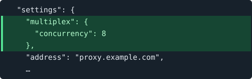

# Multiplex

Multiplex позволяет нескольким запросам к разным адресам использовать одно соединение между клиентом Xray и сервером. Например, когда браузер открывает сайт, клиент может передать запросы к странице, изображениям и другим ресурсам по уже открытому соединению. Для передачи UDP-пакетов через такое соединение Xray использует XUDP. Multiplex поддерживают исходящие VLESS и VMess. Для других исходящих протоколов, включая SOCKS, HTTP, Shadowsocks и Trojan, используются обычные подключения.

## Структура конфигурации клиента

Ниже — полный `config.json` для клиента VLESS с TLS без Vision. Приложение подключается к локальному SOCKS5 на `127.0.0.1:1080`, а Xray передаёт его запросы серверу VLESS. Для своего подключения укажите домен сервера вместо `proxy.example.com`, его порт и UUID пользователя.

```json {21-23}
{
  "log": {
    "loglevel": "info"
  },
  "inbounds": [
    {
      "listen": "127.0.0.1",
      "port": 1080,
      "protocol": "socks",
      "settings": {
        "auth": "noauth",
        "udp": true
      }
    }
  ],
  "outbounds": [
    {
      "tag": "proxy",
      "protocol": "vless",
      "settings": {
        "multiplex": {
          "concurrency": 8
        },
        "address": "proxy.example.com",
        "port": 443,
        "id": "5783a3e7-e373-51cd-8642-c83782b807c5",
        "encryption": "none"
      },
      "streamSettings": {
        "security": "tls"
      }
    }
  ]
}
```

- `inbounds[0]` задаёт точку входа для приложений. Здесь это SOCKS5 с поддержкой TCP и UDP на локальном компьютере.
- `outbounds[0].settings` содержит адрес, порт и учётные данные сервера VLESS. Внутри этого же объекта находится `multiplex`. Если исходящих подключений несколько, у каждого свои настройки.
- `multiplex.concurrency: 8` разрешает до восьми одновременно активных потоков на одном соединении с сервером. Если все места заняты, следующий поток пойдёт через другое соединение.
- `streamSettings.security: "tls"` включает TLS для подключения к серверу. Сервер VLESS или VMess автоматически распознаёт запрос Multiplex.



## Общий пул соединений

### `concurrency`

Задаёт число одновременных потоков на одном соединении общего пула. Тип — целое число без кавычек. По умолчанию — `0`.

| Значение | Пример в `multiplex` | Как работает |
| --- | --- | --- |
| Поле пропущено или `0` | `{"concurrency": 0}` | Общий пул выключен. TCP идёт обычным способом. |
| От `1` до `1024` | `{"concurrency": 8}` | Общий пул включён. В примере одно соединение обслуживает до восьми потоков одновременно. Если отдельный пул UDP выключен, общий пул принимает и TCP, и UDP. |
| От `1025` до `32767` | `{"concurrency": 1025}` | Xray принимает значение. За всё время работы одно соединение обслужит не более 1024 потоков, включая уже завершённые. |
| Отрицательное число, число выше `32767`, дробь или строка | `{"concurrency": -1}` | Ошибка при загрузке конфигурации. |

## Передача UDP через Multiplex (XUDP)

### `xudpConcurrency`

Задаёт число одновременных UDP-потоков на одном соединении отдельного пула UDP. Тип — целое число без кавычек. По умолчанию — `0`.

| Значение | Пример в `multiplex` | Как работает |
| --- | --- | --- |
| Поле пропущено или `0` | `{"xudpConcurrency": 0}` | Отдельный пул UDP выключен. UDP использует общий пул, если тот включён. Если оба пула выключены, протокол обрабатывает UDP обычным способом. |
| От `1` до `1024` | `{"xudpConcurrency": 16}` | UDP идёт через отдельный пул. В примере одно соединение обслуживает до 16 UDP-потоков одновременно. Путь TCP определяется полем `concurrency`. |
| От `1025` до `32767` | `{"xudpConcurrency": 1025}` | Xray принимает значение. Здесь тоже действует предел в 1024 потока за всё время работы одного соединения. |
| Отрицательное число, число выше `32767`, дробь или строка | `{"xudpConcurrency": -1}` | Ошибка при загрузке конфигурации. |

### `xudpProxyUDP443`

Определяет, как передавать UDP-пакеты на порт назначения `443`, когда для запроса выбран пул. Тип — строка в нижнем регистре. По умолчанию — `"reject"`. Порт подключения к самому прокси-серверу задаётся отдельно в `settings.port`.

| Значение | Пример в `multiplex` | Как работает |
| --- | --- | --- |
| Поле пропущено, `""` или `"reject"` | `{"concurrency": 8, "xudpProxyUDP443": "reject"}` | Xray отклоняет пакеты на UDP-порт 443. |
| `"allow"` | `{"concurrency": 8, "xudpProxyUDP443": "allow"}` | Пакеты идут через выбранный пул. Подходит, например, для QUIC через XUDP. |
| `"skip"` | `{"concurrency": 8, "xudpProxyUDP443": "skip"}` | Пакеты идут обычным способом для данного протокола. В этом режиме VLESS с `flow: "xtls-rprx-vision"` отклоняет UDP на порт 443. Для XDrive без Reverse значение `"skip"` недопустимо. |
| Любая другая строка | `{"concurrency": 8, "xudpProxyUDP443": "ALLOW"}` | Ошибка при загрузке конфигурации. |

## Как сочетать параметры

В правом столбце показано значение объекта `multiplex`.

| Как должен идти трафик | Значение `multiplex` |
| --- | --- |
| TCP и UDP используют общий пул | `{"concurrency": 8}` |
| TCP идёт обычным способом, UDP использует отдельный пул | `{"xudpConcurrency": 16}` |
| TCP и UDP используют разные пулы | `{"concurrency": 8, "xudpConcurrency": 16}` |
| Оба протокола работают обычным способом | `{}` или пропустите `multiplex` |

**VLESS Vision.** Сервер с `flow: "xtls-rprx-vision"` принимает через Multiplex только UDP. Для такого подключения оставьте общий пул выключенным и задайте `xudpConcurrency`, если хотите объединять UDP-потоки.

**XDrive без Reverse** требует включённого общего пула. Укажите `"multiplex": {"concurrency": 128}`. При значении от `1` до `127` Xray применит `128`. Отдельный пул `xudpConcurrency` можно добавить к общему. Для VLESS Reverse клиент открывает собственное соединение. [Настройки VLESS](./outbounds/vless.md#multiplex)

## Конфигурация VMess с отдельным пулом для UDP

В этом варианте клиент также принимает запросы приложений на `127.0.0.1:1080`. TCP передаётся обычным способом для VMess. Для UDP клиент использует отдельный пул с лимитом в 16 потоков на соединение. Значение `"allow"` разрешает передавать через этот пул и UDP на порт назначения 443.


<details>
<summary>Полный config.json для VMess с TLS</summary>

```json {21-24}
{
  "log": {
    "loglevel": "info"
  },
  "inbounds": [
    {
      "listen": "127.0.0.1",
      "port": 1080,
      "protocol": "socks",
      "settings": {
        "auth": "noauth",
        "udp": true
      }
    }
  ],
  "outbounds": [
    {
      "tag": "proxy",
      "protocol": "vmess",
      "settings": {
        "multiplex": {
          "xudpConcurrency": 16,
          "xudpProxyUDP443": "allow"
        },
        "address": "proxy.example.com",
        "port": 443,
        "id": "5783a3e7-e373-51cd-8642-c83782b807c5",
        "security": "auto"
      },
      "streamSettings": {
        "security": "tls"
      }
    }
  ]
}
```

</details>

## Запуск и проверка

1. Сохраните конфигурацию с параметрами своего сервера в `config.json`. Выполните `xray run -test -c config.json`. Команда проверяет файл без подключения к серверу.
2. Запустите клиент командой `xray run -c config.json`. Укажите в приложении SOCKS5-прокси с адресом `127.0.0.1` и портом `1080`.
3. Отправьте через прокси запрос и проверьте ответ. Для первого примера подойдёт TCP-запрос из браузера. Для второго нужен UDP-запрос из приложения с поддержкой UDP через SOCKS5.
4. В обоих примерах включён [журнал уровня info](./log.md). Когда запрос попадает в пул, строка `dispatching request to` компонента `proxy/vless/multiplex` показывает адрес назначения. В примере VMess эта строка относится к UDP.

## Как обновить старую конфигурацию

Раньше `mux` находился рядом с `protocol` и `settings`. Теперь удалите этот ключ. Если Multiplex был включён, перенесите нужные параметры в `settings.multiplex` исходящего VLESS или VMess. Ниже пример замены `mux.enabled: true`, когда число потоков раньше не указывалось.


Если старый `mux` остался, Xray при загрузке конфигурации выводит предупреждение в консоль и игнорирует его. При наличии обоих ключей используются только новые настройки. Для других исходящих протоколов, например Shadowsocks и Trojan, Xray использует их обычные соединения.

Отрицательное число в новом объекте вызывает ошибку. Обратите внимание на старое `xudpConcurrency: -1`: раньше оно исключало UDP из общего пула. Новое значение `0` отключает только отдельный пул UDP. Если `concurrency` положителен, UDP по-прежнему может использовать общий пул.

Если вы добавляете исходящее подключение через API, передайте `multiplex` в конфигурации самого VLESS или VMess. Старое поле `SenderConfig.multiplex_settings` игнорируется. [Документация для старых сборок](https://github.com/XTLS/Xray-docs-next/blob/0caf7ea80eb491eb1d6d7fc8cc7c347f55198e22/docs/ru/config/outbound.md#muxobject)

## Если результат отличается от ожидаемого

- **Появилось предупреждение о старом `mux`.** Проверьте запись в `outbounds`: старый ключ рядом с `protocol` игнорируется. Действует `multiplex` внутри `settings`.
- **На клиенте с XHTTP появилось `ATTENTION: Using VLESS Multiplex over XHTTP XMUX`.** Клиент сообщает, что включён общий пул VLESS поверх XHTTP с его собственным механизмом XMUX. Запуск продолжается. [Multiplex поверх XHTTP](./transports/xhttp.md#multiplex)
- **Обычные запросы работают, но UDP на порт 443 не проходит.** Для пулов по умолчанию действует `reject`. Если нужен QUIC через пул, в том же объекте `multiplex` укажите `"xudpProxyUDP443": "allow"`.
- **Нужно выключить пулы.** Для обычного VLESS или VMess конфигурация с пустым объектом `"multiplex": {}` или без этого поля использует обычные соединения. Учитывайте отдельное требование XDrive к общему пулу.

Формат команд и кадров описан в [спецификации Mux.Cool](../development/protocols/muxcool.md).
