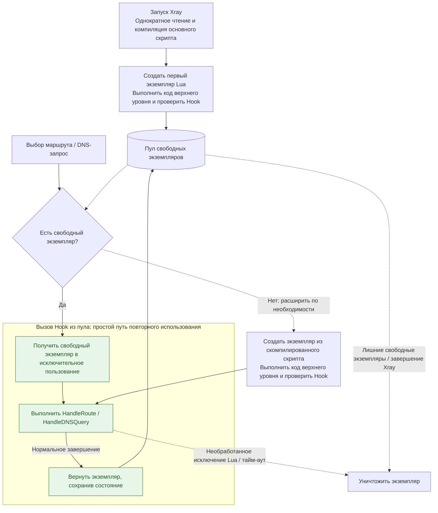

# Экземпляры и жизненный цикл

Способ управления экземплярами в точке входа скрипта определяет создание экземпляров Lua, вызовы Hook, сохранение состояния и уничтожение экземпляров. На этой странице правила описаны по типам жизненного цикла.

## Жизненный цикл пула

Сейчас [HandleRoute](../reference/hook-routing.md) в [скриптах маршрутизации](./routing.md) и [HandleDNSQuery](../reference/hook-dns.md) в [скриптах DNS](./dns.md) используют экземпляры из пула. Следующие правила применяются к обоим Hook.

### Пулы экземпляров и инициализация

Скрипты маршрутизации и DNS подключаются через поле `script` в соответствующих настройках и управляют отдельными пулами экземпляров Lua. Даже если указан один и тот же файл, состояние внутри экземпляров Lua не разделяется.

При запуске Xray один раз читает и компилирует скрипт, затем создаёт первый экземпляр, выполняет код верхнего уровня и проверяет наличие обязательного обработчика. Ошибка чтения файла, синтаксиса, выполнения кода верхнего уровня или проверки обработчика препятствует запуску Xray.

### Вызовы Hook и возврат экземпляров

Каждый выбор маршрута или DNS-запрос получает экземпляр в исключительное пользование. Свободный экземпляр используется повторно; если параллельным вызовам нужны дополнительные экземпляры, они создаются из скомпилированного скрипта с повторным выполнением кода верхнего уровня.

После нормального завершения обработчика экземпляр может вернуться в пул для повторного использования. Необработанное исключение Lua или превышение времени выполнения уничтожает экземпляр. Сообщение об ошибке обработки через возвращаемые значения или ошибка их проверки не равнозначны исключению выполнения Lua: экземпляр можно использовать повторно. Лишние свободные экземпляры уничтожаются автоматически.

Если есть свободный экземпляр, путь вызова каждого Hook прост: **получить экземпляр → выполнить Hook → вернуть экземпляр**. Чтение и компиляция скрипта выполняются при запуске Xray. Зелёные узлы на схеме показывают этот обычный путь.



### Состояние в экземплярах пула

Глобальные переменные, переменные `local` верхнего уровня, замыкания и кеш модулей `require` принадлежат текущему экземпляру. Они сохраняются между вызовами, которые он обрабатывает, и теряются при его уничтожении:

```lua
local calls = 0

function HandleRoute()
    calls = calls + 1
    return "direct", "instance-call-" .. calls
end
```

Счётчик выше отражает только число вызовов, обработанных текущим экземпляром. У разных экземпляров независимые значения `calls`, и запросы не обязательно попадают в один экземпляр. Этот счётчик нельзя использовать как общий для всех соединений или как постоянное состояние отдельного соединения.

Рекомендуется размещать код инициализации, например загрузку модулей Lua, создание объектов сопоставления и сохранение объектов DNS-серверов, вне функции Hook, на верхнем уровне скрипта. Он выполняется один раз при создании каждого экземпляра, а результаты могут повторно использоваться его последующими вызовами Hook.

### Тайм-ауты и обновление скриптов

Сейчас тайм-аут инициализации каждого экземпляра маршрутизации и DNS составляет **120 секунд**, а выполнения каждого вызова обработчика — **6 секунд**. Тайм-аут вызова отсчитывается после получения экземпляра; отдельных полей конфигурации для этих значений пока нет. При вызовах API Xray фактическая отмена также зависит от того, реагирует ли API на сигнал отмены; отдельный DNS-сервер дополнительно ограничен настройкой `timeoutMs`.

Xray не отслеживает и не перекомпилирует основной скрипт автоматически. После его изменения перезапустите Xray, чтобы изменения вступили в силу. Экземпляры, созданные позже, также используют основной скрипт, скомпилированный при текущем запуске.
